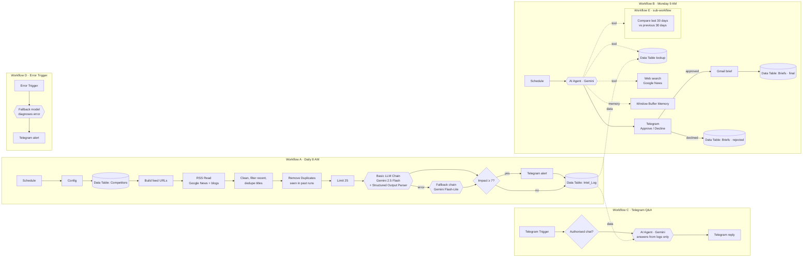

# AI Competitive Intelligence & Strategy Brief Agent

An **n8n + Google Gemini** agent that watches competitors every day, classifies and scores their moves, alerts on the important ones, and writes a **partner-style weekly strategy brief** that a human approves before it becomes final. Built entirely on a **₹0 / free-tier stack**.

**Market tracked:** product-management / work-management software. **Competitors:** Notion, Atlassian (Jira, Confluence, Rovo), Asana, monday.com, Linear. You can change them by editing one n8n Data Table.

---

## What it does

| | |
|---|---|
| **Daily** | Pulls Google News and competitor blog RSS feeds, drops items it has already seen, then uses Gemini to put each item into a category (*pricing, product_launch, hiring, partnership, campaign, other*) and score its **impact from 1 to 10**, returning structured JSON |
| **Alerts** | Items scoring **≥ 7** go to Telegram straight away. Everything is logged to an n8n Data Table |
| **Weekly** | An **AI Agent** with tools (Data Table lookup, web search, and a "compare with last month" sub-workflow) writes a brief with headline moves, a SWOT delta per competitor, threats and opportunities, and **3 recommended actions** |
| **Human in the loop** | The brief is sent to Telegram with **Approve / Decline** buttons. Only approved briefs are marked *final* and emailed |
| **Q&A** | Ask the Telegram bot *"What did Asana do on pricing this quarter?"* It answers **only from logged data, with sources** |
| **Reliability** | Retries, a **fallback model** (Gemini Flash-Lite) if the main model fails, and an **Error Trigger** workflow that sends an AI-diagnosed alert to Telegram |

## Architecture



## Tech stack (all free tier)

| Layer | Tool |
|---|---|
| Orchestration | **n8n** Community Edition, self-hosted (`localhost:5678`) |
| LLM | **Google Gemini API**: `gemini-2.5-flash` (main), `gemini-2.5-flash-lite` (fallback) |
| AI building blocks | n8n LangChain nodes: Basic LLM Chain, Structured Output Parser, AI Agent, Window Buffer Memory, Tool Workflow, HTTP Request Tool, Data Table Tool |
| Storage | **n8n Data Tables** (`Competitors`, `Intel_Log`, `Briefs`), built into n8n, no external account |
| Data sources | Google News RSS (`when:2d` queries), company blog RSS feeds |
| Interface | **Telegram bot** (alerts, approvals, Q&A), **Gmail** (weekly brief) |
| Code | JavaScript in n8n Code nodes (feed building, cleaning, 30-day deltas) |

## Repository layout

```
workflows/   n8n workflow exports (credentials removed)
  A_daily_collection.json     daily collect → classify → alert → log
  B_weekly_brief.json         weekly analyst agent + human approval + Gmail
  C_telegram_qa.json          Telegram Q&A agent
  D_error_handler.json        Error Trigger + fallback model + Telegram alert
  E_compare_last_month.json   sub-workflow used as an agent tool
sheets/      CSV templates for the three n8n Data Tables (columns + seed competitors)
docs/        PRD, case study + ROI, evaluation plan, metrics, v2 roadmap
evaluation/  labelled evaluation set template + scoring script
```

## Setup (about 30 minutes)

1. **Data Tables**: in n8n open *Overview → Data tables* and create `Competitors`, `Intel_Log` and `Briefs` with the columns from `sheets/*.csv` (all text, except `impact_score` as a number). Add the competitor rows from `Competitors.csv`.
2. **Gemini key**: get a free API key at <https://aistudio.google.com/apikey>. In n8n, add a **Google Gemini (PaLM) API** credential.
3. **Telegram bot**: talk to **@BotFather**, send `/newbot` and copy the token into an n8n **Telegram API** credential. Send any message to your bot, then open `https://api.telegram.org/bot<TOKEN>/getUpdates` to find your `chat.id`.
4. **Gmail**: add a **Gmail OAuth2** credential in n8n.
5. **Import** the five JSON files (*Workflows → ⋯ → Import from File*), in this order: **D, E, A, B, C**.
6. In each workflow, open the **Config** node and fill in `telegram_chat_id` and (for B) `brief_email`. Select your credentials on the red-flagged nodes.
7. In **B** and **C**, open the `compare_with_last_month` tool and pick workflow **E**. In **Settings → Error workflow** of A, B, C and E, pick **D**.
8. Run **A** manually once, then check the `Intel_Log` data table and Telegram. **Activate** A, B and D.
9. **C (Telegram Trigger)** needs a public HTTPS URL. Start n8n behind a tunnel (for example `cloudflared tunnel --url http://localhost:5678` or ngrok) with `WEBHOOK_URL=<tunnel url>`, then activate C.

> Telegram approval buttons in B open an n8n "waiting" URL. They work from the same PC on `localhost`. To approve from your phone, use the tunnel URL from step 9.

## Key design decisions

- **Structured output over free text**: the classifier must return a JSON schema (`category` enum, `impact_score` 1–10, `is_relevant`, `summary`, `reasoning`), so its results can be filtered, alerted on and evaluated.
- **Calibrated scoring rubric** in the prompt (9–10 market-changing, 7–8 alert-worthy, and so on) keeps alerts rare and useful.
- **Cost guards for the free tier**: a 2-day lookback, at most 4 items per feed, at most 25 LLM calls per run, deduplication across runs (`Remove Duplicates`) and within a run (syndicated titles).
- **Fallback model**: if the main classifier fails after 3 retries, its *error output* routes the item to a Flash-Lite chain, so the item is still logged and tagged with `model_used`.
- **Grounded agents**: the Q&A agent may answer only from tool data and must cite links, otherwise it says *"I don't have logged data on that yet."*
- **Human approval** before any recommendation becomes "final" (n8n *Send and Wait* on Telegram).
- **No external database**: n8n Data Tables keep storage inside n8n, with no OAuth and no Drive quota.
- **Least privilege**: the Q&A bot only answers your own Telegram `chat.id`.

## Docs

- [Product Requirements (PRD)](docs/PRD.md)
- [Case study + ROI estimate](docs/case_study.md)
- [Evaluation plan and success metrics](docs/evaluation.md)
- [v2 roadmap](docs/roadmap.md)

## Limitations

Google News snippets are short, so classification sometimes relies on the headline alone. Free-tier Gemini quotas limit how many items can be processed per day. n8n Data Tables are fine for thousands of rows; at larger scale or for semantic search, move to Supabase (Postgres + pgvector). Telegram triggers need a public URL when n8n is self-hosted.

